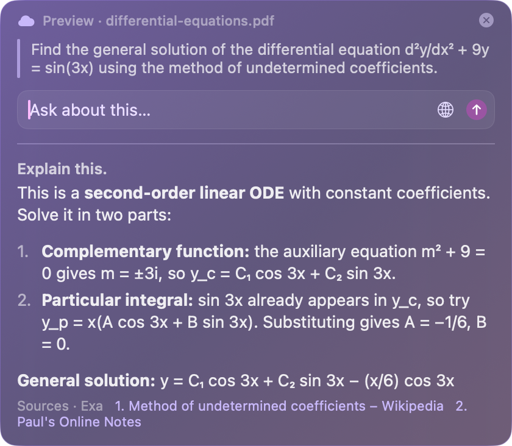
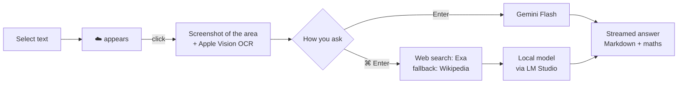

<div align="center">

# ☁️ Mist

**A study buddy that lives inside macOS.**
Select text in any app, click the little cloud, and ask about it, without switching windows.




</div>

---

## Why

Reading something hard usually means breaking your flow: copy, open a tab, paste, search, read, come back.
Mist puts the answer next to the text you're reading, in whatever app you're reading it in.

- **Works everywhere.** PDFs in any browser, Preview, notes apps, web apps. Mist reads the screen itself instead of
  relying on each app to expose its text.
- **Never steals focus.** The panel floats without activating, so your selection and your place stay put.
- **Reads maths properly.** The image of what you selected goes to the model alongside the recognised text, so
  formulas like d²y/dx² survive (screen OCR alone garbles them).
- **Fast and quiet.** Nothing is read until you click the cloud. It fades away if you ignore it.

## How you use it

| Action | What happens |
|---|---|
| **Select text**, then click the ☁️ | Mist reads that area of the screen and opens the panel |
| **Ctrl + Option + X** | Drag a box over anything (text, maths, a diagram) and ask about it |
| **Ctrl + Option + Space** | Ask a general question |
| **Enter** | Answer with Gemini Flash |
| **⌘ + Enter** or 🌐 | Search the web first, then answer with numbered sources |
| **Esc** | Close the panel |

## How it works



- **App:** Swift and AppKit. A non-activating `NSPanel`, global gesture monitors, ScreenCaptureKit and Vision.
- **Models:** one adapter per provider. Gemini (Interactions API, with automatic fallback across models) and any
  OpenAI-compatible local server (LM Studio). Images go to both.
- **Search:** Exa for the general web, Wikipedia as a free fallback. A relevance filter drops sources that only
  share a name with what you're reading.

## Verified maths solver (experimental)

`solver/` is an attempt at a maths helper that **only answers when it can prove the answer is right**.

1. A local model reads the question and writes **SymPy** code. It never does arithmetic itself.
2. The code runs in a **sandbox** (`sandbox-exec`: no network, writes only to a temp folder, time-limited).
3. An **independent checker** tests every claimed result: substitution for ODEs, numerical integration for
   Laplace and Fourier results, rank tests for linear algebra, an independent solver for linear programs, and more.
4. If every check passes, you get a step-by-step explanation. Every number in it is filled in from the computed
   working, never typed by the model. Otherwise it says it **couldn't solve the question reliably** instead of guessing.

```sh
cd solver
.venv/bin/python -I solve.py "Find the general solution of y'' + 9y = sin(3x)."
```

## Setup

**You need:** macOS 14+ on Apple Silicon, the Xcode command-line tools (`xcode-select --install`), and a free
[Gemini API key](https://aistudio.google.com/apikey). Optional: an [Exa](https://exa.ai) key for web search and
[LM Studio](https://lmstudio.ai) with a small model (e.g. Qwen 3.5 4B, MLX) for search answers and the solver.

**1. Add your keys.** They live in your home folder, never in this repository:

```sh
mkdir -p ~/.config/mist && chmod 700 ~/.config/mist
printf '%s' 'YOUR_GEMINI_KEY' > ~/.config/mist/gemini_key   # or export GEMINI_API_KEY=...
printf '%s' 'YOUR_EXA_KEY'    > ~/.config/mist/exa_key      # optional, or export EXA_API_KEY=...
chmod 600 ~/.config/mist/*
```

**2. Build and run:**

```sh
cd app && ./build.sh && ./mist
```

**3. Grant permissions** to the app you run Mist from (System Settings → Privacy & Security):
**Accessibility** and **Screen Recording**.

**Optional: local model and solver**

```sh
lms server start                       # LM Studio's server, with a model loaded
cd solver && python3 -m venv .venv && .venv/bin/pip install -r requirements.txt
```

| Variable | Default | Purpose |
|---|---|---|
| `MIST_LOCAL_MODEL` | `qwen/qwen3.5-4b` | Local model for search answers and the solver |
| `MIST_MODEL` | — | Put a specific Gemini model first in line |
| `MIST_DEBUG` | off | Show timings in the panel and print prompts in the terminal |

## Privacy

- Nothing on screen is read until you click the cloud.
- Screenshots stay in memory and are dropped when the panel closes. Region captures are written to a temporary
  file by macOS and deleted immediately.
- `timings.csv` and `errors.log` (created next to the app) record timings, the app name and error messages, never
  your question or the selected text. Both are git-ignored.
- Your question goes only to the provider you choose: Gemini, Exa, or your own local model. Note that Gemini's
  free tier may use requests to improve Google's products.

## Project layout

```
app/Sources/      the macOS app (Swift, AppKit)
solver/           verified maths solver (Python, SymPy, sandboxed)
solver/eval/      sample questions and an evaluation runner
probes/           small experiments from development: text-capture probe, local-model benchmark
docs/             images for this README
```

## Status and roadmap

Mist is an early prototype built for personal study. Next up:

- [ ] A stronger local model for the solver (the 4B model writes working code for only about 1 in 4 questions)
- [ ] Q&A history and Markdown export to notes
- [ ] Flashcards and spaced repetition from your highlights
- [ ] Settings for answer length, depth and tone
